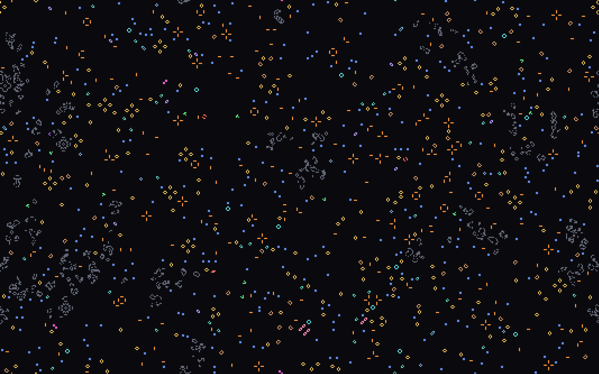
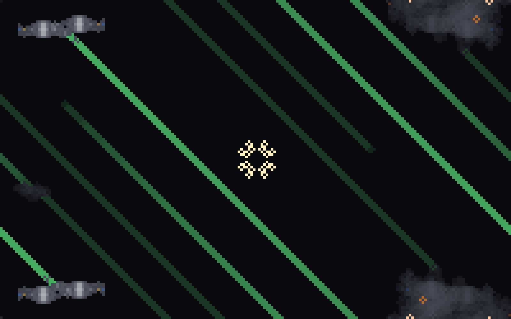
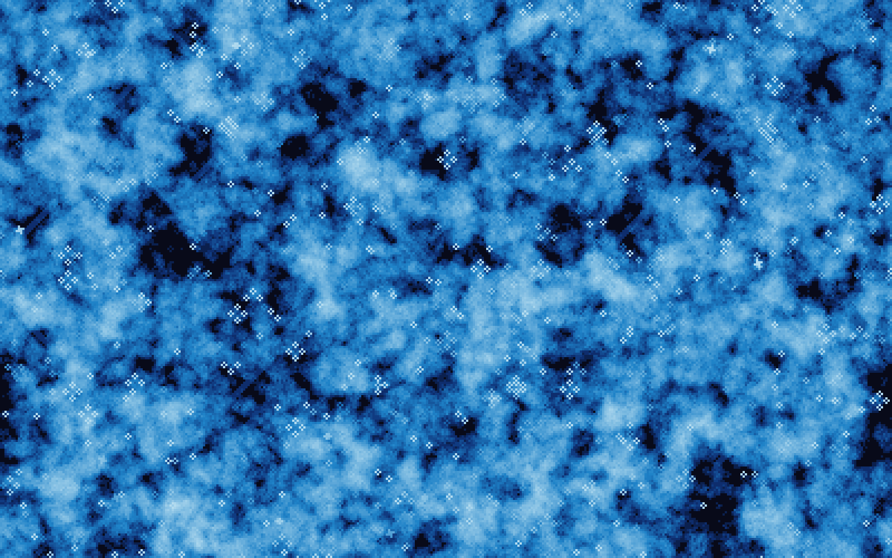
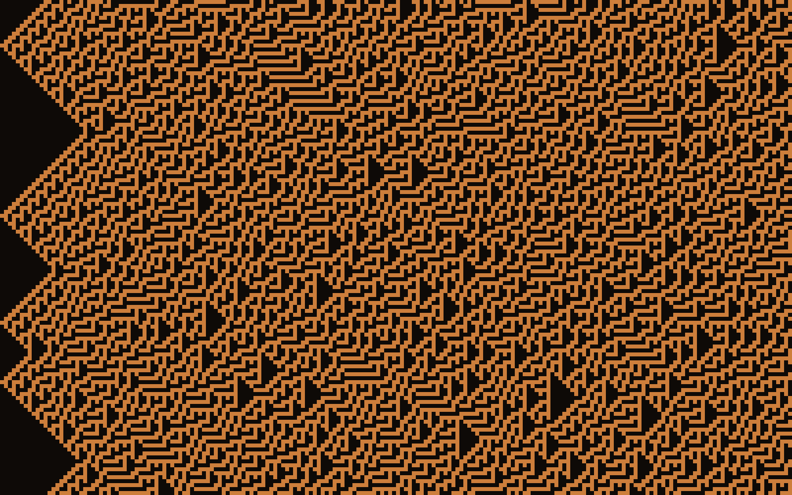
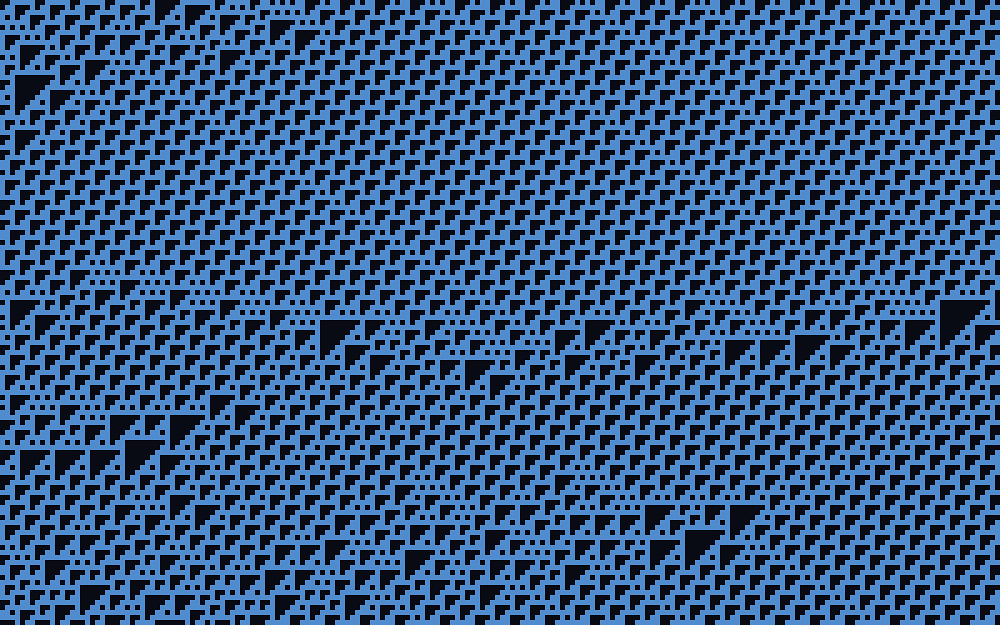

# life-wallpaper

Desktop wallpapers grown from Conway's Game of Life and Wolfram's elementary cellular automata.
`apply` detects every connected display, renders one image at that display's native pixel
resolution, and sets it as that display's desktop picture (macOS).

[日本語の README](README.ja.md)



| | |
|---|---|
|  |  |
| `05_motif_colors_heatmap` — glider guns and oscillators, coloured by motif | `02_random_heatmap` — how long each cell stayed alive |
|  |  |
| `eca02_chaos_rule30` — elementary CA, rule 30 | `eca03_class4_rule110` — elementary CA, rule 110 |

The top image is the default for `apply` (`10_motif_field_hires_t1500`). All samples are 1600x1000, seed 42.

## Install

### As a Claude Code plugin

```text
/plugin marketplace add nhoribee/life-wallpaper
/plugin install life-wallpaper@life-wallpaper
```

Then ask Claude to "update the wallpaper" (skill `life-wallpaper`).

### As a plain CLI

```bash
git clone https://github.com/nhoribee/life-wallpaper
cd life-wallpaper
./run.sh apply --dry-run
```

Requirements: macOS (for `apply`), Python 3.13+, [uv](https://docs.astral.sh/uv/).
`ffmpeg` is needed only for `--video`.

## Commands

| Command | What it does |
|---|---|
| `apply [--config C] [--seed N] [--keep N] [--dry-run]` | Render one still per connected display at its physical resolution and set it as that display's wallpaper. Cell size is matched to the main display in points and rounded to whole pixels. `--dry-run` renders without setting anything |
| `generate --config C [--resolution R] [--seed N] [--output DIR] [--format png\|webp] [--gif \| --video]` | Render a Game of Life still, GIF, or MP4 |
| `eca --config C [--resolution R] [--seed N] [--output DIR] [--video]` | Render an elementary cellular automaton still or side-scrolling MP4 |
| `atlas [--output FILE]` | Build an HTML page that runs every config in `config/` in the browser for comparison |
| `check` | Format check, lint, shellcheck, type check, tests |

| Argument | Meaning | Default |
|---|---|---|
| `--config C` | Config JSON path, or a name in `config/` (`.json` optional) | `apply`: `10_motif_field_hires_t1500`; required for `generate` / `eca` |
| `--resolution R` | `macbook` (3024x1964), `ultrawide` (3840x1600), `4k` (3840x2160), or `WxH` (each side ≤ 16384) | `macbook` |
| `--seed N` | Random seed. Same config + resolution + seed → identical image | 42 (`apply`: random per display) |
| `--keep N` | Images kept per display by `apply` | 5 |
| `--output DIR` | Output folder for `generate` / `eca` | `~/Pictures/life-wallpaper/output/` |

Exit codes: 0 success, 1 failure, 2 usage error.

## Where files go

Everything is written under `~/Pictures/life-wallpaper/` (set `LIFE_WALLPAPER_HOME` to change it):
`output/` for `generate` / `eca`, `desktop/` for `apply` (each image has a JSON sidecar with the
seed and config needed to reproduce it), `atlas/` for the atlas page.

## Notes

- Displays are read through `osascript` (JXA → AppKit `NSScreen`); wallpapers are set with
  `NSWorkspace setDesktopImageURL:forScreen:options:error:`, keeping each display's scaling and
  fill colour. Only the Space currently visible on each display changes.
- macOS does not refresh a wallpaper whose path is unchanged, so file names include a timestamp.
- Pruning never deletes an image currently shown on any display, but it cannot see other Spaces.
- Tests never run `osascript`; the real desktop is never touched under pytest.
- The atlas page re-implements the simulation in JavaScript. If you change
  `lifewallpaper/life.py` or `lifewallpaper/motifs.py`, update `lifewallpaper/atlas_template.html` too.
- Source comments and CLI messages are in Japanese.

## License

MIT
